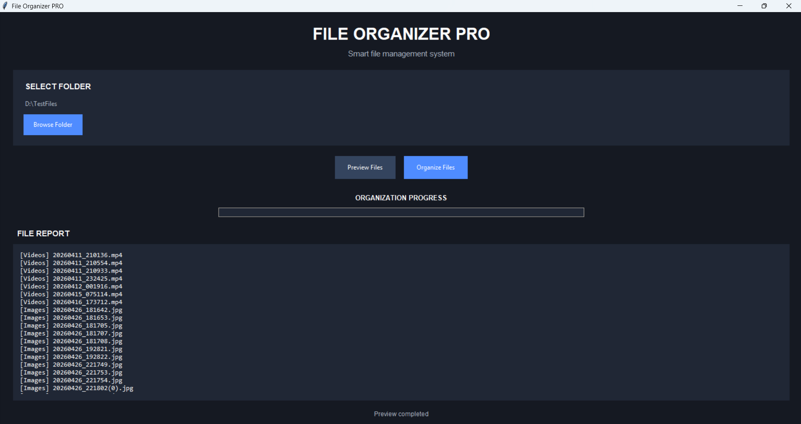

# 📁 File Organizer PRO

A modern Python file organizer with a clean Dark GUI.

## 🚀 Features

- Dark user interface
- Automatic file organization
- File preview system
- Category statistics
- Progress bar
- Duplicate filename protection
- Error reporting
- Windows EXE support

## 📂 Supported File Categories

| Category | File Extensions |
|---|---|
| Images | JPG, PNG, GIF, WEBP |
| Documents | PDF, DOCX, TXT, XLSX |
| Videos | MP4, AVI, MKV, MOV |
| Music | MP3, WAV, FLAC |
| Archives | ZIP, RAR, 7Z |

## 🛠️ Technologies

- Python
- Tkinter
- pathlib
- shutil

## 💻 Installation

Install Python, then run:

```bash
python main.py
```

## 🖥️ Windows EXE

A Windows executable can be created with:

```bash
pip install pyinstaller
pyinstaller --onefile --windowed --name FileOrganizer main.py
```

The executable will be available in the `dist` folder.

## 📌 About

This is a personal portfolio project created to demonstrate Python programming and GUI development skills.

## 👨‍💻 Developer

GitHub: CodeCraftStudio26
## 📸 Screenshot


